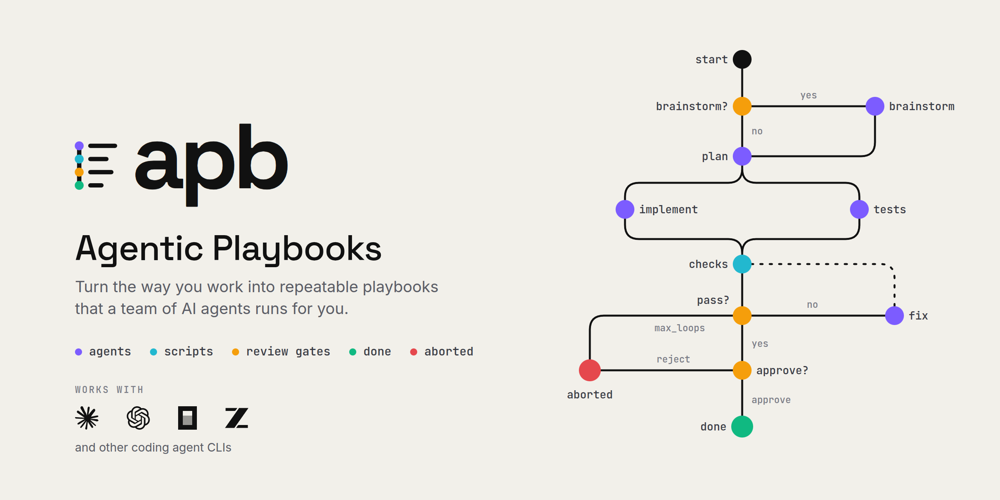
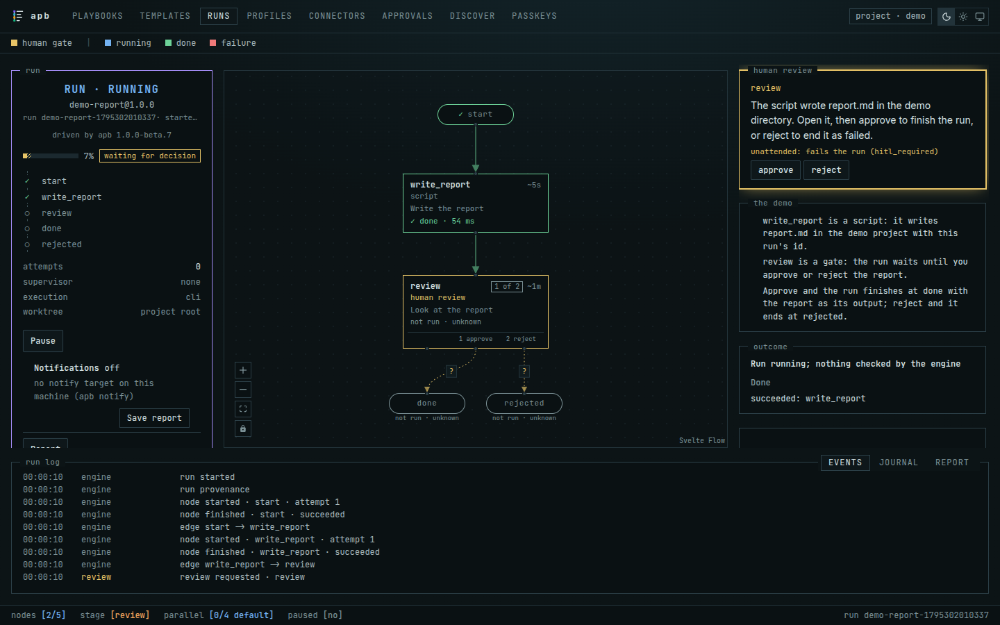
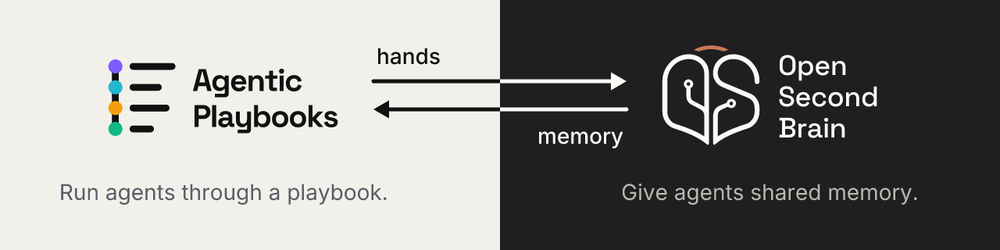

<p align="center"></p>

# Give your agent a playbook for the work you keep explaining

Ask Claude Code, Codex or another supported agent to write down the steps for
reviewing a code change or sorting unread mail. Each time you run that
playbook, `apb` follows the same steps on your machine and waits for your
approval at each review step you add.

**[Run the built-in demo](docs/FIRST-RUN.md)**: one command on your machine.
It writes a report and waits for your approval, with no agent and no API key.

**[Meet Open Second Brain](#give-your-agents-memory-with-open-second-brain)**:
the companion project that gives the same agents a shared memory.

<p align="center"></p>

<p align="center"><em>The demo has written its report. You decide whether the run continues.</em></p>

## What you get

### Stop explaining the same work

- **Explain it once.** Describe a routine a single time. From then on your
  agents go through the same steps on every run.
- **Your agent writes the playbook.** Ask Claude Code or Codex to save what
  you just did together. You never have to write the file by hand.
- **It finds your next playbook.** `apb` looks through your Claude Code and
  Codex sessions on this machine, spots what you keep repeating and hands
  you a draft.
- **Start with ready ones.** Code review and mail sorting come with `apb`.
  Use a gallery template to start your own playbook.
- **Not only code.** Reviews, mail, documents, records: a routine with
  steps and checks fits.

### Trust what comes back

- **Done means checked.** `apb` runs the checks your playbook names and
  marks a step done only when they pass, not because an agent said so.
- **See what happened.** Follow the run step by step in the dashboard, and
  get a one-page report: what was done, what was checked, and what nobody
  checked.
- **Pick up where it stopped.** After a crash, a used-up quota or a
  reboot, `apb resume` continues the run at the step it stopped on. Steps
  that finished are not run again.
- **Nothing goes out twice.** A send through a
  [connector](docs/CONNECTORS.md) that declares send-once is recorded before
  it leaves and is not repeated when the run resumes. When `apb` cannot tell
  whether it went out, it leaves the decision to you instead of sending again.

### Routines that improve and run on their own

- **Playbooks get better with use.** `apb` suggests edits based on what
  people corrected and where agents struggled. You decide what to apply, and
  you can compare the new version with the current one before you switch.
- **Let it run without you.** Once the same playbook has succeeded under
  your eye, you can let it start on its own when something arrives, while
  you do something else.
- **A team, not a single agent.** One agent writes, another reviews, a third
  looks things up, each on the model that fits. A backup steps in when the
  first choice is not available.
- **Agents that remember.** With
  [Open Second Brain](#give-your-agents-memory-with-open-second-brain) the
  same agents keep what earlier runs decided.

### Use your own tools and see the cost up front

- **Works with your services.** Mail, Google and other web services become
  steps of a playbook, with your keys and your permissions.
- **Try a playbook in seconds.** Play it through without an agent and
  without spending anything, before the first real run.
- **Know the cost first.** See an estimate before you start, based on
  earlier runs of the same playbook. A first run has no history, and says so.
- **Yours to keep.** One program on your machine or your own server. No
  account and no hosted service required.

## Two playbooks you can run

Both ship with `apb`.

**Review a code change**
Ask once: "For each change I bring you, check correctness, security, tests
and maintainability. Give me one report."
Each run reviews those four areas while the project's own checks run. You
get the findings and the check results in one report. The review leaves
your code untouched.

**Sort unread mail**
Ask once: "Tell me which unread messages need action and which need a
reply."
Each run reads the mail folder you approved, checks every classification and
writes a digest beside your files. Your messages stay unread.

## Give your agents memory with Open Second Brain

<p align="center"><a href="https://github.com/itechmeat/open-second-brain"></a></p>

[Open Second Brain](https://github.com/itechmeat/open-second-brain) is a
separate open source project by the same author. `apb` runs the agents; Open
Second Brain gives those agents memory, so they can use decisions and
corrections recorded in earlier runs. Each works without the other.

## Install

**The easy way: let your agent do it.** Open your coding agent in your
project and paste this prompt.

```text
Read https://raw.githubusercontent.com/itechmeat/agentic-playbooks/main/llms.txt
and follow its agent setup procedure. Install apb if needed and check the
installation. Run the read-only setup plan for this project. Show me the
proposed changes, warnings, and anything I need to decide. Stop and wait for
my explicit approval. Apply only the plan I approved, using its digest and
the same project. If the plan changes, show me the new plan and wait for
approval again. Verify setup and tell me how to undo it.
```

**By hand.** On macOS or x86_64 Linux, one command installs `apb`:

```sh
curl --proto '=https' --tlsv1.2 -LsSf https://github.com/itechmeat/agentic-playbooks/releases/latest/download/apb-installer.sh | sh
```

Then `apb setup plan` shows what setup would add to this machine, and writes
nothing until you apply it.

**Everything else.** Homebrew, `cargo install`, pinned versions, checksums, a
source build, updating and uninstalling: [the full install guide](docs/INSTALL.md).

## What you control

Run history stays beside your project files. Agents and scripts use the
access you already have, so read a playbook from someone else as you would
read code before you run it.

- You choose which agents may start. Billed agent work needs your explicit
  approval by default.
- Scripts of an imported playbook run only after you approve the exact
  content you reviewed.
- Before a push, the publish step shows the commits, the destination and the
  branch, and waits for a person to approve that plan.

The [1.x compatibility promise](docs/COMPATIBILITY.md) covers saved
playbooks, run journals and the tools agents call.

## Documentation

- [Your first run](docs/FIRST-RUN.md): the local demo, a shipped playbook, a playbook of your own
- [Install guide](docs/INSTALL.md): every way to install, update and remove `apb`
- [Write a playbook](docs/HOWTO-authoring.md): steps, checks, review gates, loops and lists
- [Connect a service](docs/CONNECTORS.md): mail and other services a playbook can call
- [Use it from your agent](docs/MCP.md): the tools a coding agent gets
- [Command line reference](docs/CLI.md): every command in one map
- [Safety model](docs/GUARDRAILS.md): what `apb` enforces and what it only advises
- [All documentation](docs/README.md): the full index, grouped by task

[Contributing](CONTRIBUTING.md) · [Security](SECURITY.md) · [Apache License 2.0](LICENSE)
