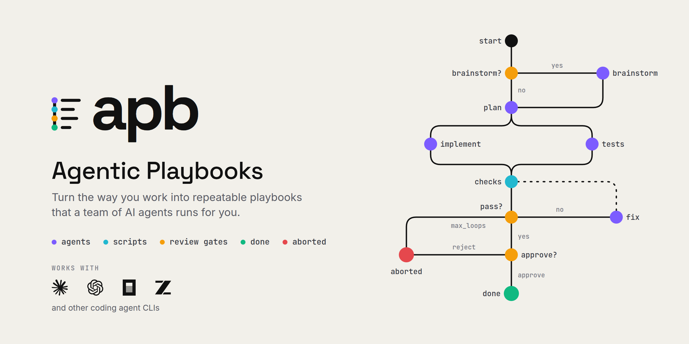

<p align="center"></p>

# Agentic Playbooks - `apb`

Repeatable multi-step workflows for coding agents, defined in YAML and executed
locally. One binary: the execution engine, a visual web editor, and an MCP
server your agent can drive.

You already ask Claude Code (or another agent) to "plan, implement, lint, fix,
repeat" by hand. A playbook turns that into a versioned artifact: agent tasks,
scripts, conditions, review gates, and parallel branches wired into a graph
that runs the same way every time, survives restarts, and leaves a full event
log behind.

## Why `apb`

- **Playbooks as YAML.** Node types: `agent_task`, `script`, `condition`,
  `human_review`, `wait` (timer/webhook), parallel branches with `join`.
  Templating over params and node outputs, retries, fallbacks, timeouts. An
  `agent_task` can be marked `interactive: true` to ask the user a question
  mid-run and wait for an answer.
- **Your coding agents, via profiles.** Claude Code, Codex, OpenCode, Cursor
  Agent, Grok, Hermes, Qoder, Antigravity, Pi and ZCode. A profile binds agent + model + ordered
  fallbacks + role prompt + skills. Nodes reference profiles by name; swapping
  models never means editing the playbook.
- **Recorded and resumable runs.** The graph, not the agent, decides what
  runs next. Append-only event log, immutable
  per-run snapshot of the playbook and profiles, `apb resume` after a crash,
  `apb pause` to stop a run for a while and continue it later with its clocks frozen.
- **Visual editor and live monitor.** `apb dashboard` opens a svelte-flow web UI:
  edit YAML and graph side by side, watch runs light up node by node.
- **Built for agents, not just humans.** `apb mcp` exposes the whole surface
  as MCP tools, so an agent can create, run, and supervise playbooks itself.
- **Self-improving playbooks.** A supervisor agent can watch a run, retry or
  reroute nodes, patch the playbook mid-run; successful patches are promoted
  into a new version.
- **Local-first.** No cloud, no accounts. State lives in `.apb/` next to your
  code; versions are immutable and diffable.

## Requirements

- macOS (Apple silicon or Intel) or Linux x86_64. Windows works through WSL2;
  Linux on ARM needs a source build. See [docs/INSTALL.md](docs/INSTALL.md).
- At least one coding agent CLI, installed and signed in: Claude Code, Codex,
  OpenCode, Cursor Agent, Grok, Hermes, Qoder, Antigravity, Pi or ZCode.
  Playbooks made only of `script` nodes need no agent.
- A git repository to run playbooks in.

## Install

Shell installer (macOS, Linux x86_64):

```sh
curl --proto '=https' --tlsv1.2 -LsSf https://github.com/itechmeat/agentic-playbooks/releases/latest/download/apb-installer.sh | sh
```

It installs the `apb` binary to `CARGO_HOME` (`~/.cargo/bin` by default) and
needs no build tools. Update with `apb self-update`.

Homebrew is equivalent; update with `brew upgrade apb`:

```sh
brew install itechmeat/agentic-playbooks/apb
```

The `apb` crate on crates.io is an unrelated project, so `cargo install apb`
does not install this tool. Version pinning, manual downloads with checksum
and attestation checks, building from source, and uninstalling:
[docs/INSTALL.md](docs/INSTALL.md).

## Quick start

A playbook that plans a task with an agent, runs a lint script, and lets the
agent fix the result until the lint passes (at most three times).

1. Set up a project and a profile. A profile says which agent and model run
   a node; `apb detect` lists the agents and models apb found on this machine.

   ```sh
   cd my-project            # any git repository
   apb init                 # creates .apb/
   apb profile write architect --agent claude --model claude-opus-5-5
   ```

2. Save the playbook as `.apb/playbooks/implement-task/1.0.0/playbook.yaml`:

   ```yaml
   schema: 2
   id: implement-task
   name: Implement Task
   version: 1.0.0

   params:
     - { name: task, type: text, label: "Task" }

   defaults:
     profile: architect

   nodes:
     - { id: start, type: start, title: Start }
     - id: plan
       type: agent_task
       title: Plan
       expected_duration: 3m
       prompt: |
         Write a plan: {{params.task}}
     - { id: lint, type: script, title: Lint, expected_duration: 10s, script: scripts/lint.sh, runner: sh }
     - { id: check, type: condition, title: Passed?, max_loops: 3 }
     - id: fix
       type: agent_task
       title: Fix
       expected_duration: 5m
       prompt: |
         Fix: {{nodes.lint.output}}
     - { id: done, type: finish, outcome: success }

   edges:
     - { from: start, to: plan }
     - { from: plan, to: lint }
     - { from: lint, to: check }
     - { from: check, to: done, condition: { type: node_status, node: lint, equals: success } }
     - { from: check, to: fix, condition: { type: node_status, node: lint, equals: failure } }
     - { from: fix, to: lint }
   ```

3. Add the lint script next to it, as
   `.apb/playbooks/implement-task/1.0.0/scripts/lint.sh`, and mark `1.0.0` as
   the current version:

   ```sh
   #!/bin/sh
   # Replace with your real linter; a non-zero exit sends the run to "fix".
   set -e
   test -f README.md || { echo "README.md is missing"; exit 1; }
   echo "lint ok"
   ```

   ```sh
   printf '1.0.0\n' > .apb/playbooks/implement-task/current
   ```

4. Check it and run it:

   ```sh
   apb validate implement-task
   apb run implement-task --param task="add a health endpoint"
   apb dashboard            # watch runs and edit playbooks at http://127.0.0.1:7321
   ```

The dashboard can also create playbooks from scratch, and a coding agent can
write them for you over MCP (see below). The full playbook format, node types
and templating are in [docs/HOWTO-authoring.md](docs/HOWTO-authoring.md).

## Everyday commands

```text
apb init            create the .apb structure
apb list            playbooks and versions
apb validate        validate playbooks, the profiles and scripts they reference, requires and connectors
apb run <id>        run a playbook (--param k=v, --overrides, --supervise, --detach, --execution, --confirm-irreversible)
apb wait <run>      block until a run finishes, needs input or stops (exit code = verdict)
apb runs [run]      list runs, or one run with its execution mode and tokens (--json)
apb pause <run>     pause a run (--drain default, --now, --reason, --until, --keep-lock)
apb resume <run>    resume a paused or interrupted run (--all: runs a lost driver or a passed pause left waiting)
apb stop <run>      stop a run: interrupt the running node, finalize if the driver is gone
apb note <run> <t>  post a note (context append) to a run's control channel
apb review          decide a pending human_review node
apb answer <run> <t> answer an interactive node's pending question (--node)
apb tasks [run]     host tasks of host-mode runs; `apb tasks submit` replies to one
apb trash list      deleted playbooks; `apb trash restore <name|id>` brings one back
apb trust list      approvals in the trust store; `apb trust revoke <digest|id>` removes them
apb dashboard       web UI (port 7321)
apb mcp             stdio MCP server for coding agents
apb self-update     update apb to the latest release (--check only reports)
```

Profiles, environment and analysis:

```text
apb detect          detect installed coding agents and their models (local checks only)
apb profile         list / show / write / edit / move / delete agent profiles
apb subscriptions   view or declare the agent subscriptions you pay for
apb connector       list / show / call / approve / doctor / env / init / install / test - connectors to external services
apb migrate         migrate schema 1 playbooks (executors) to schema 2 (profiles)
apb adopt           adoption readiness report for a playbook
apb doctor          diagnose agents, profiles, runners, playbooks (--run <id> for one run's health)
apb export/import   move a playbook as a single bundle file
apb suggestions     list / allow / reset save-as-playbook suggestion declines
apb stats           cross-run metrics per playbook version and node (read-only)
apb eval <id>       run a playbook's eval cases in scratch repositories (opt-in, paid)
apb cache           status / inspect / prune / clear the node result cache
apb decide          ask the configured decision models a bounded question
apb decisions       decision-model report, stored thresholds, replay
apb projects        list / remove entries of the workspace registry
apb ingest          only the inbound webhook listener (headless)
apb server key      issue / list / revoke the keys that protect a networked dashboard
```

## Use from a coding agent (MCP)

`apb mcp` serves the current project's playbooks over stdio MCP. The server
identifies itself as `agentic-playbooks` to MCP clients. Claude Code:

```sh
claude mcp add agentic-playbooks -- apb mcp
```

or in the project's `.mcp.json`:

```json
{ "mcpServers": { "agentic-playbooks": { "command": "apb", "args": ["mcp"] } } }
```

For global scope (available in all projects), add `--scope user`:

```sh
claude mcp add --scope user agentic-playbooks -- apb mcp
```

Other MCP-compatible hosts (Codex, OpenCode, etc.): add a stdio MCP server
with command `apb` and args `["mcp"]`, using the name `agentic-playbooks`.

Tool families: playbook CRUD and validation, run control (`playbook_run`,
`run_wait`, `run_status`, `run_events`, `run_report`, `run_pause`, `run_resume`, `run_stop`), profile and advisory
tools, and supervisor tools.

**Supervised runs.** `playbook_run` with `supervise: "self"` starts the run in
the background and hands the calling agent a supervisor token. The agent then
loops: `supervisor_wait_event` -> `supervisor_run_inspect` -> intervene if
needed (`supervisor_node_retry`, `supervisor_run_continue_from`,
`supervisor_patch_playbook`, `supervisor_run_abort`, ...) -> `supervisor_report`.
Alternatively, `apb run <id> --supervise` spawns a separate supervisor agent
with heartbeat monitoring and a fallback respawn. Capabilities are gated per
playbook policy. Details: [docs/MCP.md](docs/MCP.md).

## Status

Released on the `0.x` line (the latest release is `0.26.0`); each tagged
release has its notes in [docs/release-notes/](docs/release-notes/) and on
the GitHub releases page. The engine, web editor, versioning, MCP surface, and
supervisor are implemented and tested; until `1.0` the schema and CLI may
still change between minor releases. Design specs live in
[docs/superpowers/specs/](docs/superpowers/specs/).

## Documentation

- [Install](docs/INSTALL.md): platforms, installer, Homebrew, manual download, source build, uninstall
- [Playbook authoring](docs/HOWTO-authoring.md): the playbook format, node types, edges, conditions, templating
- [Profiles](docs/PROFILES.md): agent, model, fallbacks, role prompt and skills
- [MCP tools](docs/MCP.md): the tool surface for coding agents, supervision, safety model
- [Host integration](docs/HOST-INTEGRATION.md): host-mode runs where the calling agent executes the tasks
- [Interactive agents](docs/INTERACTIVE-AGENTS.md): nodes that ask the user a question mid-run
- [Playbook interview](docs/HOWTO-interview.md): capturing a process as a playbook by interviewing the user
- [Connectors](docs/CONNECTORS.md): calling external services from playbooks
- [Guardrails](docs/GUARDRAILS.md): which controls advise and which enforce
- [Decision models](docs/DECISIONS.md): optional small models for checks, judges and ranking
- [Run stats](docs/STATS.md) and [evals](docs/EVALS.md): measuring playbooks across runs
- [CI](docs/CI.md) and [deployment](docs/DEPLOYMENT.md): running apb in pipelines and on a server

## Development

```sh
(cd web && bun install && bun run build)   # the binary embeds web/dist
cargo test --workspace                      # engine, core, server, CLI tests
cd web && bun run test                      # frontend tests (vitest)
cd web && bun run dev                       # dev frontend with a proxy to :7321
apb dev                                     # Vite HMR + API from the source tree
```

Contributor guide, gates and the third-party notices workflow:
[CONTRIBUTING.md](CONTRIBUTING.md).

## Security

> [!WARNING]
> Playbooks can execute local scripts and invoke coding agents. Treat third-party
> playbooks and imported bundles as executable code, and review them before running.

By default the dashboard binds `127.0.0.1` with no authentication, which is safe
only because nothing off the machine can reach it. To run it on a server, issue
an authorization key and put it behind a reverse proxy that terminates TLS:

```sh
apb server key issue     # printed once, stored only as a hash
apb dashboard --no-open  # keep the loopback bind, let the proxy reach it
```

With at least one key present, every `/api` route requires either
`Authorization: Bearer apb_...` or a session cookie obtained by signing in
through the dashboard. Binding a non-loopback address with no key configured is
refused at startup. The full runbook, including Caddy and nginx examples, a
systemd unit, and a fail2ban filter, is in
[docs/DEPLOYMENT.md](docs/DEPLOYMENT.md).

Do not expose `apb mcp` to untrusted users; it speaks stdio and has no
authentication of its own.

Please report suspected vulnerabilities privately as described in
[SECURITY.md](SECURITY.md).

## Contributing

Contributions are welcome. Please read [CONTRIBUTING.md](CONTRIBUTING.md).
All commits must be signed off under the [Developer Certificate of Origin](DCO).

### Help apb improve: the feedback loop

apb is under active development, and the most valuable reports come from real
supervised runs. If you drive playbooks through a coding agent, add the block
below to your `CLAUDE.md` or `AGENTS.md` so the agent reports what it hits
(`apb init` offers to add it for you). The full reporting instruction lives in
[docs/FEEDBACK-LOOP.md](docs/FEEDBACK-LOOP.md).

```markdown
## apb feedback loop (standing instruction)

apb (agentic-playbooks) is under active development. On every playbook run you
supervise from this workspace, collect flaws, bugs, and improvement ideas that
belong to apb itself (the MCP server, the playbook engine, the validator, the
supervisor tools, the run lifecycle). Keep those separate from problems that
belong to this project's own playbooks, profiles, or prompts.

When the run is finished and the list is not empty, follow the reporting
instruction in
https://github.com/itechmeat/agentic-playbooks/blob/main/docs/FEEDBACK-LOOP.md
to check existing issues and file one consolidated issue for the run. Never
include secrets, tokens, or private prompt content in an issue.
```

## License

Licensed under the [Apache License, Version 2.0](LICENSE).
